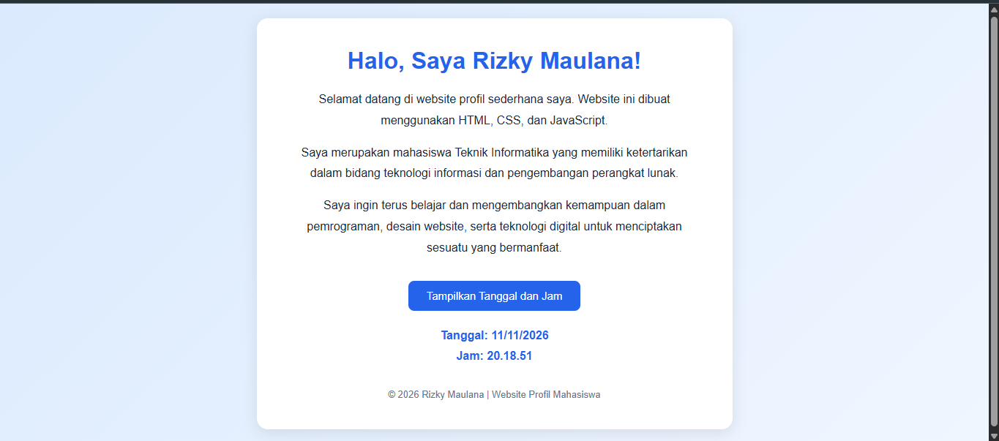

# Website Profil Mahasiswa

## Identitas
- Nama: Rizky Maulana
- NPM: 24552011345
- Kelas: TIF RP24E

## Deskripsi
Website profil mahasiswa sederhana yang dibuat
menggunakan HTML, CSS, dan JavaScript.

## Teknologi
- HTML: Membuat struktur halaman website.
- CSS: Mengatur tampilan dan desain website.
- JavaScript: Membuat tombol interaktif untuk
  menampilkan tanggal dan jam.

## Screenshot Website

## Fitur
1. Menampilkan profil mahasiswa.
2. Memiliki tiga paragraf deskripsi.
3. Desain background gradasi biru.
4. Tombol untuk menampilkan tanggal dan jam.

## Cara Menjalankan
Buka file index.html menggunakan browser
seperti Google Chrome.
